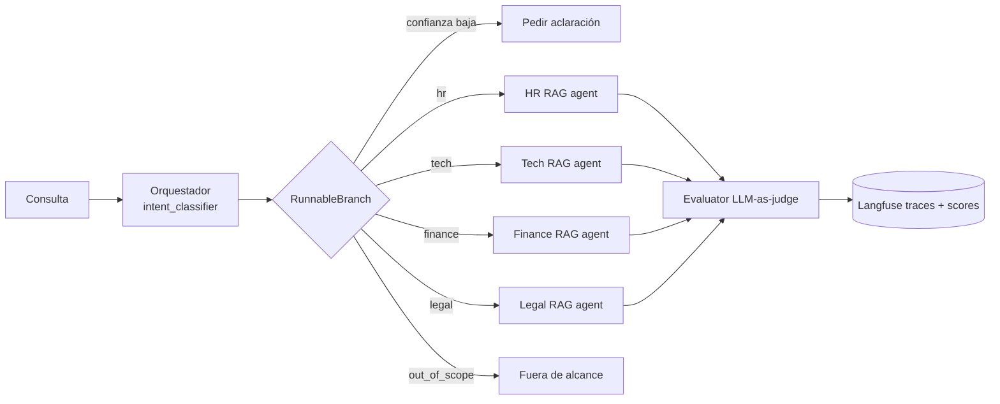

# PI-M3 · Sistema Multi-Agente de Soporte Interno con LangChain + Langfuse

Sistema de **routing inteligente** para la mesa de soporte de **NubeSoft S.A.**, una empresa SaaS ficticia.
Un **Agente Orquestador** clasifica la intención de cada consulta y la enruta de forma condicional a uno de
**cuatro agentes RAG especializados**: HR, IT/Tech, Finance y Legal. Cada agente responde fundamentado en la
documentación interna de su área. Todo el flujo queda trazado en **Langfuse**, y un **Agente Evaluador**
(bonus) puntúa cada respuesta de 1 a 10 con la Score API de Langfuse.



## Estructura del repositorio

```
PI-M3/
├── multi_agent_system.ipynb     # Notebook principal (secciones 1-6 + bonus)
├── src/
│   ├── config.py                # Modelos, rutas, dominios y parámetros de RAG/routing
│   ├── ingest.py                # Loaders, chunking con tiktoken y FAISS persistido por dominio
│   ├── multi_agent_system.py    # Ensambla todo + tracing con Langfuse (MultiAgentSystem.ask)
│   ├── evaluator.py             # BONUS: evaluador LLM-as-judge + Langfuse Score API
│   └── agents/
│       ├── orchestrator.py      # Clasificador (structured output) + RunnableBranch
│       ├── rag_agent.py         # Fábrica genérica de agentes RAG (LCEL)
│       ├── hr_agent.py
│       ├── tech_agent.py
│       ├── finance_agent.py
│       └── legal_agent.py
├── data/
│   ├── hr_docs/                 # 5 .md + FAQ .csv  → 67 chunks
│   ├── tech_docs/               # 5 .md + FAQ .csv  → 69 chunks
│   ├── finance_docs/            # 5 .md + límites .csv → 70 chunks
│   └── legal_docs/              # 4 .md + FAQ .csv  → 65 chunks
├── test_queries.json            # 20 consultas con la categoría esperada (incluye casos borde)
├── tests/test_offline.py        # Smoke test sin API keys (modelos falsos)
├── requirements.txt
└── .env.example
```

## Instalación

Requisitos: **Python 3.10 o superior** (probado con 3.12), una API key de **OpenAI** y un proyecto en
**Langfuse Cloud** (gratuito en https://cloud.langfuse.com) o en Langfuse self-hosted.

```bash
# 1. Clonar el repositorio y entrar a la carpeta
git clone <url-del-repo>
cd PI-M3

# 2. Crear y activar un entorno virtual
python -m venv .venv
# Windows:
.venv\Scripts\activate
# macOS / Linux:
source .venv/bin/activate

# 3. Instalar dependencias
pip install -r requirements.txt

# 4. Configurar las API keys
cp .env.example .env          # en Windows: copy .env.example .env
# editar .env y completar OPENAI_API_KEY, LANGFUSE_PUBLIC_KEY, LANGFUSE_SECRET_KEY y LANGFUSE_HOST
```

Las claves de Langfuse están en *Project → Settings → API Keys*. Si Langfuse no está configurado, el sistema
funciona igual pero sin tracing ni scores.

Para verificar la instalación sin gastar API, corré el smoke test offline:

```bash
python -m tests.test_offline
```

## Cómo ejecutar el notebook

1. Abrir `multi_agent_system.ipynb` en Jupyter (`jupyter notebook`) o en VS Code, con el kernel del `.venv`.
2. Ejecutar **todas las celdas en orden** (*Run All*). El orden importa porque cada sección usa objetos
   de la anterior:

| Sección | Qué hace | Costo aproximado |
|---|---|---|
| 1. Setup e imports | Carga `.env`, verifica las claves y valida Langfuse (`auth_check`) | — |
| 2. Documentos y vector stores | Inventario de documentos, verificación de ≥50 chunks por dominio, embeddings y FAISS | ~USD 0,001 la primera vez; después se carga desde `vectorstores/` |
| 3. Agentes RAG | Crea los 4 agentes y prueba uno de forma directa | 1 llamada |
| 4. Orquestador | Prueba el clasificador y el pipeline de enrutamiento | 4 llamadas |
| 5. Pruebas y ejemplos | Ejemplos por agente + suite de 20 test queries con accuracy y matriz de confusión | ~45 llamadas |
| 6. Langfuse | Links a las trazas, ejemplo de sesión multi-turno y `flush()` | 6 llamadas |
| 7. Bonus: evaluador | Evaluación en línea, evaluación de toda la suite y falla inyectada | ~20 llamadas |

Con `gpt-4o-mini`, una corrida completa cuesta menos de USD 0,05.

## Ejemplos de uso

Desde el notebook (sección 5) o desde cualquier script en la raíz del proyecto:

```python
from src.multi_agent_system import MultiAgentSystem

system = MultiAgentSystem()

r = system.ask("¿Cuál es el tope de hotel por noche en Madrid?", user_id="ana", session_id="s-1")
print(r["route"], r["handled_by"], r["confidence"])   # finance finance_agent 0.95
print(r["answer"])                                    # ... EUR 180 por noche ... [02_viajes_y_viaticos.md]
print(r["sources"], r["trace_id"])

# Con el evaluador (bonus): agrega relevance, completeness, accuracy, quality_score y needs_human_review
r = system.ask("¿Qué hago si me roban la notebook?", evaluate=True)
print(r["evaluation"])

# Medir routing contra una categoría esperada (genera el score routing_correct en Langfuse)
system.ask("vpn", expected_route="tech")

system.flush()   # enviar los eventos pendientes a Langfuse
```

Celdas para ver cada funcionalidad:
- Routing y respuesta: celdas *"Ejemplos individuales"* y *"Caso borde"* de la sección 5.
- Métricas de routing: celdas *"Suite completa"* y *"Matriz de confusión"* de la sección 5.
- Tracing: sección 6. Los links llevan directamente a cada traza en Langfuse.
- Evaluación: sección 7.

## Qué se ve en Langfuse

Cada consulta es **una traza** con el árbol de ejecución completo:

```
support_request (agent)            input, output, user_id, session_id, tags
└── orchestrator
    ├── intent_classifier          RouteDecision {department, confidence, reasoning} + tokens/costo
    ├── conditional_router
    │   └── finance_rag_agent
    │       ├── finance_retriever  chunks recuperados (contenido + fuente)
    │       └── finance_generation prompt con contexto + respuesta
    ├── finalize
    └── quality_evaluator          (si evaluate=True)
```

Scores por traza: `route` (categórico), `routing_confidence`, `routing_correct` (si se pasa
`expected_route`), y, con el evaluador, `relevance`, `completeness`, `accuracy`, `quality_score` y
`needs_human_review`.

**Cómo depurar una consulta mal enrutada:** filtrar las trazas por `routing_correct = 0` o por
`routing_confidence` baja, abrir la traza y leer el `reasoning` del `intent_classifier`. Si el routing fue
correcto pero la respuesta es mala, revisar el `*_retriever` para distinguir un retrieval fallido de una
generación incorrecta.

## Decisiones técnicas

| Decisión | Alternativas consideradas | Por qué |
|---|---|---|
| **LCEL** (`Runnable`, `RunnablePassthrough.assign`, `RunnableBranch`) | `LLMChain`, `initialize_agent` (vistos en clase) | Las APIs legacy están deprecadas en LangChain 1.x. LCEL es composable, soporta batch y streaming, y cada paso tiene un `run_name` que aparece como nodo propio en Langfuse. |
| **Clasificador con `with_structured_output(RouteDecision)`** | Keywords (L3 `collaboration_patterns`), parsear texto libre (L4), tool-calling sin argumentos (L3 `query_router`) | La salida se valida con Pydantic, así que la categoría siempre es un valor del `Literal`. Además devuelve **confianza** y **razonamiento**, que es lo que se necesita para depurar misclassifications. Las keywords fallan con sinónimos, typos e idiomas. |
| **`RunnableBranch`** para el enrutamiento condicional | `StateGraph` de LangGraph con `add_conditional_edges` | El flujo es lineal (clasificar → un agente). Una rama LCEL alcanza, es más simple y se traza igual de bien. LangGraph tendría sentido si hubiera ciclos, handoffs entre agentes o memoria de estado. |
| **Umbral de confianza (0,5) → pedir aclaración** | Enrutar siempre a la clase más probable | Un ticket mal enrutado cuesta más que una repregunta. Las consultas vagas no se adivinan. |
| **Rama `out_of_scope` determinística** (sin LLM) | Delegar a un agente "general" | No gasta retrieval ni tokens y evita respuestas inventadas sobre temas ajenos a la empresa. |
| **Reglas de desempate y few-shot** en el prompt del clasificador | Zero-shot | Resuelven los solapamientos reales: el recibo de sueldo es de HR y no de Finance; el reembolso de un curso es de Finance aunque lo apruebe HR; un robo de notebook es primero un incidente de IT. |
| **Un índice FAISS por dominio** | Un índice único con filtro por metadata; Chroma/Pinecone | El conocimiento queda aislado y un agente no puede recuperar políticas de otra área. FAISS es local, gratuito, sin servidor y persistible con `save_local`. Se usó en las clases (L2). |
| **Chunks de 200 tokens (overlap 30) medidos con tiktoken** y separadores por encabezado Markdown | 500-1000 caracteres fijos | Las políticas son secciones cortas y autocontenidas, y un chunk chico recupera exactamente la regla consultada. Medir en tokens refleja el consumo real del modelo. |
| **Retriever MMR** (`k=4`, `fetch_k=20`) | Similarity search pura | Evita devolver 4 fragmentos casi idénticos de la misma sección y aporta contexto complementario. |
| **CSVLoader para FAQs y tablas de límites** | Convertir todo a texto | Cada fila es un documento atómico (una pregunta y su respuesta, o un límite con su unidad), ideal para retrieval preciso. |
| **Prompt de grounding con citas y "no sé"** | Prompt genérico | Reduce alucinaciones. La respuesta se puede auditar por la fuente, y el evaluador puede medir accuracy contra el contexto. |
| **Una fábrica `build_rag_agent`** + un archivo por agente | Cuatro implementaciones copiadas | Toda la lógica RAG vive en un solo lugar. Cada agente solo define su base de conocimiento e instrucciones de dominio. |
| **`gpt-4o-mini`, `temperature=0`** | Modelos más grandes | Bajo costo y latencia, y routing reproducible. Se puede cambiar por `.env` sin tocar código. |
| **Langfuse: span raíz + `propagate_attributes` + `CallbackHandler`** | Spans manuales como en L4 | En el ejemplo de L4 los spans se creaban *después* de la llamada al LLM (latencias incorrectas) y las generaciones no quedaban anidadas. El `CallbackHandler` traza automáticamente cada Runnable con tokens y costo, anidado bajo el span raíz. |
| **Evaluador en código con la Score API** | Solo evaluadores LLM-as-judge configurados en la UI de Langfuse | Es reproducible, queda versionado en el repo y forma parte del flujo: puede marcar `needs_human_review` **antes** de enviar la respuesta al cliente. Además se adjunta a trazas existentes para evaluar a posteriori. |
| **Modelos inyectables** en `MultiAgentSystem` | Modelos fijos | Permiten el smoke test offline sin API keys (`tests/test_offline.py`). |

## Notas de configuración

- Variables opcionales en `.env`: `OPENAI_CHAT_MODEL`, `OPENAI_EVALUATOR_MODEL` y `OPENAI_EMBEDDING_MODEL`.
- Parámetros de RAG, routing y evaluación en `src/config.py`: `CHUNK_SIZE_TOKENS`, `RETRIEVER_K`,
  `ROUTING_CONFIDENCE_THRESHOLD` y `QUALITY_REVIEW_THRESHOLD`.
- Los índices FAISS se guardan en `vectorstores/`, que no se versiona. Se reconstruyen solos si cambian los
  documentos, el modelo de embeddings o el tamaño de chunk.
- Para agregar un dominio: crear `data/<dominio>_docs/`, registrarlo en `DOMAINS` (`src/config.py`), crear su
  agente con `build_rag_agent` y sumarlo a `AGENT_FACTORIES` y al `Literal` de `RouteDecision`.
- Para usar Langfuse self-hosted, cambiar `LANGFUSE_HOST` (por ejemplo, `http://localhost:3000`).
- Para agregar documentos PDF hay que instalar `pypdf` (`pip install pypdf`).

## Limitaciones conocidas

- **Clasificación de una sola etiqueta:** una consulta que realmente necesita dos áreas se envía a la
  principal. El agente aclara qué parte corresponde a otra área, pero no consulta a ese otro agente.
- **Sin memoria conversacional:** cada consulta se procesa de forma independiente. Las sesiones de Langfuse
  agrupan las trazas, pero el agente no recuerda los turnos anteriores.
- **Documentación sintética:** las políticas de NubeSoft son ficticias, escritas para este proyecto.
- **El evaluador también es un LLM**, con sus propios sesgos: tiende a ser indulgente y puede variar entre
  corridas. Conviene calibrarlo con un set de respuestas anotadas por personas.
- **La accuracy de routing se mide sobre 20 consultas**, una muestra chica para conclusiones estadísticas.
- **El umbral de confianza depende de la autoevaluación del LLM**, que no siempre está bien calibrada.
- **FAISS en memoria** no escala a millones de documentos ni permite actualizaciones concurrentes. En
  producción convendría un vector store gestionado.
- **Costos y latencia:** cada consulta hace al menos 2 llamadas al LLM (clasificar y responder), y 3 con el
  evaluador.
